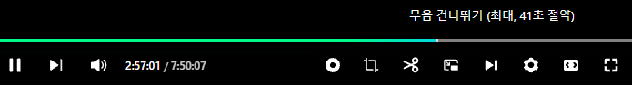
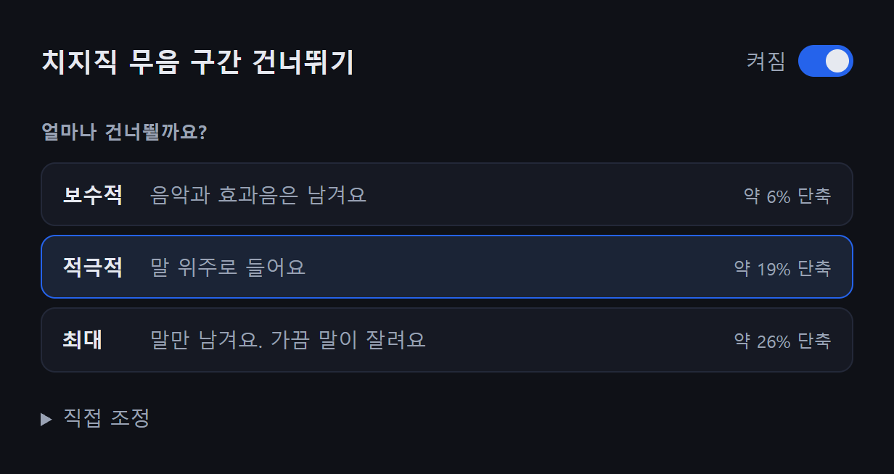

<p align="center">
  
</p>

<h1 align="center">치지직 무음 구간 건너뛰기</h1>

<p align="center">치지직 다시보기에서 말소리가 없는 구간을 자동으로 건너뛰는 크롬 확장</p>

<p align="center"></p>

## 특징

- **음량이 아니라 말소리를 봅니다.** 학습된 음성 모델이 판단하므로, 조용한 구간뿐 아니라
  배경음악이나 게임 효과음만 흐르는 구간도 건너뜁니다.
- **멈칫하지 않습니다.** 재생 위치보다 4~6분 앞서 오디오를 받아 미리 분석해 두기 때문에,
  말이 끊기는 순간 바로 다음 발화로 넘어갑니다.
- **플레이어의 일부처럼 동작합니다.** 별도 창 없이 조작 바에 버튼 하나로 들어갑니다.
  클릭하면 켜기/끄기, 마우스를 올리면 절약한 시간, 우클릭하면 설정입니다.
- **아무것도 밖으로 보내지 않습니다.** 분석은 전부 브라우저 안에서 이뤄지고, 치지직과
  네이버 영상 서버 외에는 요청하지 않습니다.

## 프리셋



| 프리셋 | 영상 단축 | 말소리 유지 |
|---|---|---|
| 보수적 | 약 6% | 98.7% |
| **적극적 (기본)** | 약 19% | 95.1% |
| 최대 | 약 26% | 92.6% |

8시간 41분짜리 방송에서, 모델 학습에 쓰지 않은 구간으로 잰 값입니다.

## 설치

웹스토어에는 아직 없습니다.

1. [Releases](https://github.com/ouor/chzzk-vod-silent-skip/releases/latest)에서
   `chzzk-skip-silence-<버전>.zip`을 받아 압축을 풉니다.
2. `chrome://extensions`에서 오른쪽 위 **개발자 모드**를 켭니다.
3. **압축해제된 확장 프로그램을 로드**를 누르고 압축을 푼 폴더를 고릅니다.

새 버전으로 바꿀 때는 같은 폴더에 덮어쓰고 확장 카드의 새로고침 버튼을 누르면 설정이 유지됩니다.

## 알아둘 점

- 다시보기 전용입니다. 라이브 방송에서는 동작하지 않습니다.
- 노래도 말소리가 아니라고 보고 건너뜁니다. 노래 방송에서는 보수적 프리셋을 쓰거나 꺼 두세요.
- 모델은 한 방송의 음향으로 학습했습니다. 음향 환경이 아주 다른 채널에서는 보수적
  프리셋부터 써 보세요.

## 개발

```bash
npm run build            # extension/dist 빌드 (소스에서 직접 불러올 때는 extension/ 폴더)
npm run package          # 릴리스용 zip
npm test                 # 단위 테스트
npm run check:browser -- https://chzzk.naver.com/video/<번호>   # 실제 다시보기에서 동작 확인
```

모델 재학습과 프리셋 보정은 [dev/README.md](dev/README.md)를 보세요.
학습용 방송 오디오와 전사는 제3자 콘텐츠라 저장소에 넣지 않습니다.

치지직이나 네이버와 관련 없는 비공식 확장입니다. [MIT](LICENSE)
